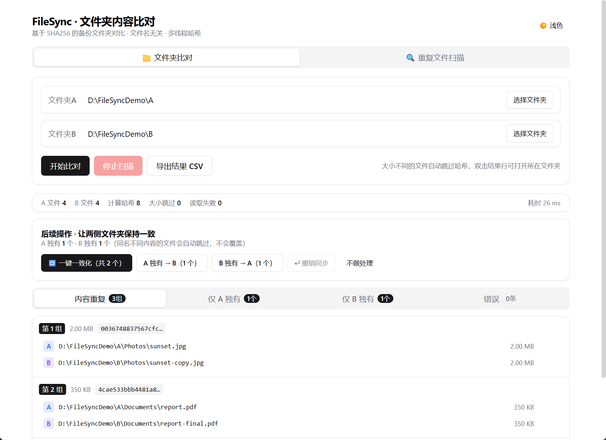
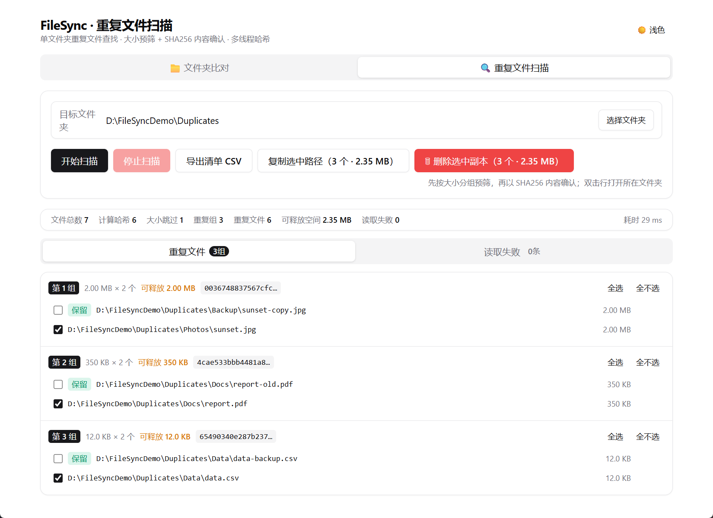

# FileSync

**基于内容哈希的文件夹比对、同步与重复文件清理工具**

[English](README.en.md) | **简体中文**

`v0.3.0` · Windows 10/11 x64 · [GPL-3.0](LICENSE) · Tauri 2 + React + Rust

FileSync 是一款面向 Windows 的本地文件管理工具。它不依赖文件名或修改时间，而是通过 **SHA256 内容哈希**判断文件是否相同，帮助你完成备份核对、迁移验证、双向同步与重复文件清理。

所有计算均在本机完成，不会上传任何文件。

## 目录

- [核心能力](#核心能力)
- [界面预览](#界面预览)
- [功能特性](#功能特性)
- [数据安全设计](#数据安全设计)
- [系统要求](#系统要求)
- [下载与安装](#下载与安装)
- [从源码运行](#从源码运行)
- [构建打包](#构建打包)
- [使用指南](#使用指南)
- [常见问题](#常见问题)
- [技术栈](#技术栈)
- [项目结构](#项目结构)
- [参与贡献](#参与贡献)
- [版本历史](#版本历史)
- [许可证](#许可证)

## 核心能力

| 模式 | 说明 |
|---|---|
| **文件夹比对与同步** | 深度比对两个文件夹，按内容找出相同 / 单侧独有文件，并可一键双向补齐或单向复制 |
| **重复文件扫描与清理** | 递归扫描单个文件夹，找出内部重复文件，将选中副本移入可撤销的 App 回收站 |

典型场景：核对备份是否完整、验证迁移后文件是否一致、让两份资料双向对齐、清理磁盘空间。

## 界面预览

### 文件夹比对



### 重复文件扫描



## 功能特性

### 文件夹比对与同步

- **内容级判断**：按 SHA256 全量哈希分组，同名不同内容、异名同内容均可正确识别
- **大小预筛加速**：另一侧不存在相同大小的文件时直接跳过哈希（内容必然不同）
- **超大文件友好**：4 MB 分块读取计算哈希，内存占用稳定，不会因超大文件耗尽内存
- **多核并行**：基于 rayon 并行哈希，线程数等于 CPU 逻辑核心数
- **实时进度**：阶段 / 侧别 / 计数 / 百分比 / 当前文件实时推送，界面保持响应
- **随时取消**：停止后保留已完成部分的结果并标记
- **四类结果视图**：重复（A∩B）/ 仅在 A / 仅在 B / 错误，Tab 切换
- **比对后同步**：

| 动作 | 行为 |
|---|---|
| 一键一致化 | A 独有 → B，同时 B 独有 → A，双向补齐 |
| 一致化选中 | 在「仅在 A / 仅在 B」列表中逐项勾选，只复制勾选的文件到另一侧（可跨两侧累计） |
| A 独有 → B | 仅把 A 独有文件复制到 B |
| B 独有 → A | 仅把 B 独有文件复制到 A |
| 不做处理 | 仅查看结果，可从统计栏重新打开操作面板 |

- 同步保留相对目录结构，自动创建目标子目录；显示实时进度，可随时停止
- **列表自动刷新**：同步 / 撤销成功后自动重新比对并更新结果列表（撤销记录保留，可继续撤销）
- **安全不覆盖**：目标侧已存在同名但内容不同的文件时自动跳过并计入「冲突」，绝不覆盖已有数据；完成后展示复制 / 冲突 / 失败统计与明细
- **同步可撤销**：撤销本次比对会话内历次同步复制的文件
  - 撤销前校验目标文件大小与复制时是否一致，被修改过的文件自动保留，防止误删
  - 目标文件已不存在视为已撤销；自动清理因此变空的目录（非空目录不受影响）
  - 进度实时显示、可停止；失败或中途停止的条目保留在记录中，可再次撤销继续
  - 撤销记录保存在内存中：开始新的比对或退出应用后失效

### 重复文件扫描与清理

- 递归遍历全部子文件夹；无权限读取 / 遍历失败的文件计入错误列表，不中断扫描
- **两阶段确认**：先按文件大小分组，大小唯一的文件直接跳过哈希（预筛）；仅对同大小文件计算 SHA256，按哈希分组，组内 ≥ 2 个文件才判定重复——绝不凭文件名判断
- 按重复组展示清单：组号、单文件大小、组内文件数、可释放空间、完整路径；双击行可在资源管理器中定位
- **清理辅助**：默认选中除首个文件外的副本（首个按路径排序为建议保留项），支持总体全选 / 全不选、组内全选 / 全不选 /「仅保留此文件」，一键复制全部选中路径（含总占用空间）
- 重复组按可释放空间降序排列，优先处理收益最大的组
- **一键删除（可撤销）**：选中副本移入 App 自管理回收站（`<App 数据目录>/filesync-trash/`，非系统回收站）
  - 删除前逐项三重校验：必须位于扫描目录内、文件仍存在、大小与扫描时一致
  - 实时进度、可随时停止；已处理的生效，未处理的保留
  - 删除后结果自动刷新：不足 2 个副本的组消失，可释放空间重算
  - 删除完成可「↩ 撤销本次删除」，文件按原路径恢复（原目录不存在会重建；原位置已有同名文件则跳过，绝不覆盖）
- **持久化回收站**：列出全部可撤销批次（时间 / 文件数 / 大小 / 来源目录），支持逐批恢复 / 打开回收站文件夹 / 彻底清空；重启 App 后仍可撤销
- 回收站操作（删除 / 恢复 / 清空）均有实时进度与停止能力，且与比对 / 同步 / 撤销同步任务互斥

### 通用能力

- **CSV 导出**：UTF-8 BOM 编码，Excel 打开中文不乱码；比对结果与重复清单均支持
- **细节交互**：双击行在资源管理器中定位；一键复制路径 / 哈希；浅色 / 深色主题
- **异常容错**：遍历 / 读取失败的文件计入错误列表，不中断整体任务
- **完全本地**：无网络请求，不上传文件与路径信息

## 数据安全设计

FileSync 会复制、移动和删除文件，因此把「不误伤数据」作为首要设计目标：

| 机制 | 说明 |
|---|---|
| 不覆盖 | 同步复制、回收站恢复遇到目标位置同名文件时一律跳过，不覆盖 |
| 删除前校验 | 删除重复文件前逐项确认：位于扫描目录内、文件仍存在、大小与扫描时一致 |
| 可撤销删除 | 文件移入 App 回收站而非直接删除，批次记录持久化，重启后仍可恢复 |
| 可撤销同步 | 同步复制记录可撤销，且校验文件大小，避免删除已被修改的文件 |
| 任务互斥 | 比对、同步、撤销、扫描、删除、回收站操作互斥，杜绝并发写入冲突 |
| 本地处理 | 所有哈希与文件操作均在本机完成，无任何网络上传 |

> **⚠️ 重要提醒**
>
> - 「清空回收站」是永久删除，不可恢复，请在确认无需恢复后再操作。
> - 回收站中的文件仍占用磁盘空间，确认无误后请及时清空。
> - 首次使用建议先在测试目录试用；重要数据请提前备份。

## 系统要求

- **操作系统**：Windows 10 / 11（x64）
- **运行时**：Microsoft Edge WebView2 Runtime（Windows 10/11 通常已随 Edge 提供；如缺失，安装程序会引导安装，需联网）
- **界面语言**：简体中文

> 目前仅支持 Windows。应用中的「在资源管理器中定位」等功能依赖 Windows，尚未适配 macOS / Linux。

## 下载与安装

### 下载

前往任一 Release 页面下载最新版本：

- **GitHub Releases**：<https://github.com/759Li/FileSync/releases>
- **GitCode Releases**：<https://gitcode.com/lzb759/FileSync/releases>

> 如果暂未发布安装包，可按下方「从源码运行」自行构建。

### 安装

1. 下载 `FileSync_<版本号>_x64-setup.exe`
2. 双击运行安装程序，按向导提示完成安装
3. 从开始菜单或桌面启动 FileSync

卸载：Windows 设置 → 应用 → 已安装的应用 → FileSync → 卸载。卸载程序不会自动清除回收站数据，详见[常见问题](#常见问题)。

### 绿色版

构建产物 `src-tauri\target\release\filesync.exe` 可直接运行；目标机器需已安装 WebView2 Runtime。

## 从源码运行

### 环境要求

| 依赖 | 版本 / 说明 |
|---|---|
| Node.js | 18+（推荐 20 LTS） |
| npm | 随 Node.js 安装 |
| Rust | stable，MSVC 工具链 |
| Visual Studio Build Tools | 2022，勾选「使用 C++ 的桌面开发」 |
| WebView2 | Windows 10/11 通常已内置 |

安装 Rust 与 VS Build Tools（如尚未安装）：

```powershell
winget install Rustlang.Rustup
winget install Microsoft.VisualStudio.2022.BuildTools
```

### 获取代码

```powershell
# GitHub
git clone https://github.com/759Li/FileSync.git

# 或 GitCode
git clone https://gitcode.com/lzb759/FileSync.git

cd FileSync
```

### 启动开发模式

```powershell
npm install       # 或 npm ci（严格按 package-lock.json 安装）
npm run tauri dev
```

首次启动需要编译 Rust 依赖，耗时取决于机器性能；之后增量编译会快很多。

### 中国大陆网络提示

若依赖下载缓慢，可切换国内镜像：

```powershell
# npm 镜像
npm config set registry https://registry.npmmirror.com

# Rust crates 镜像（可选，写入 %USERPROFILE%\.cargo\config.toml）
# [source.crates-io]
# replace-with = "rsproxy-sparse"
# [source.rsproxy-sparse]
# registry = "https://rsproxy.cn/index/"
```

## 构建打包

```powershell
npm run tauri build
```

产物位置：

- 安装包：`src-tauri\target\release\bundle\nsis\FileSync_<版本号>_x64-setup.exe`
- 绿色单文件：`src-tauri\target\release\filesync.exe`

### NSIS 离线缓存（可选）

Tauri 会把 NSIS 工具链缓存到 `%LOCALAPPDATA%\tauri\NSIS`，首次打包需要从 GitHub 下载：

- `https://github.com/tauri-apps/binary-releases/releases/download/nsis-3.11/nsis-3.11.zip`（SHA1 `EF7FF767E5CBD9EDD22ADD3A32C9B8F4500BB10D`）
- `https://github.com/tauri-apps/nsis-tauri-utils/releases/download/nsis_tauri_utils-v0.5.3/nsis_tauri_utils.dll`（SHA1 `75197FEE3C6A814FE035788D1C34EAD39349B860`）

若无法直连 GitHub，可在原始链接前拼接可用的镜像前缀（如 `https://ghproxy.net/`）下载。zip 解压后重命名为 `NSIS`；DLL 须位于 `NSIS\Plugins\x86-unicode\additional\` 子目录，且 `Include\Win\*.nsh` 等必需文件须齐全，否则 bundler 会删除缓存并重新下载。

## 使用指南

### 文件夹比对与同步

1. 启动应用，在「文件夹比对」模式下分别选择文件夹 A 与 B
2. 点击「开始比对」，等待枚举与哈希完成；可随时「停止」
3. 在结果 Tab 中查看：
   - **重复**：两侧内容完全一致的文件（按哈希分组，展示各自路径）
   - **仅在 A** / **仅在 B**：单侧独有文件
   - **错误**：无法读取 / 遍历失败的条目
4. 比对完整完成后，结果上方出现「后续操作」面板：
   - **一键一致化**：把 A 独有文件复制到 B，同时把 B 独有文件复制到 A（推荐用于双向备份对齐）
   - **一致化选中**：先在「仅在 A / 仅在 B」列表中逐项勾选文件（支持全选 / 全不选），再点击此按钮，只复制勾选的文件；A、B 两侧的勾选可一次同步
   - **A 独有 → B** / **B 独有 → A**：仅单向复制某一侧的独有文件
   - **不做处理**：关闭面板；可点击统计栏「同步操作」重新打开
5. 同步过程可停止；完成后查看复制 / 冲突 / 失败统计与明细
6. 点击「撤销同步（N 个）」撤销本次会话内历次复制：
   - 与复制时大小不一致的文件会自动保留，不会误删
   - 可停止并再次执行，以继续撤销剩余部分
7. 点击「导出结果 CSV」保存比对结果；双击条目可在资源管理器中定位
8. 同步或撤销成功后，应用会自动重新比对并刷新结果列表（撤销记录保留，仍可继续撤销）

### 重复文件扫描与清理

1. 点击顶部「🔍 重复文件扫描」切换模式
2. 选择目标文件夹（递归包含全部子文件夹），点击「开始扫描」
3. 扫描分两阶段：递归枚举并按大小预筛 → 同大小文件并行计算 SHA256
4. 结果按重复组展示（可释放空间降序）：
   - 组头：组号、单文件大小 × 文件数、可释放空间、哈希值
   - 组内：完整路径、占用空间；双击行定位文件
   - 默认选中除首个文件外的副本；可用列表上方的总体「全选 / 全不选」或组内「仅保留 / 全选 / 全不选」调整
5. 「复制选中路径」复制全部选中副本路径（含总占用空间），便于粘贴到清理脚本
6. 点击「🗑 删除选中副本」并确认：
   - 选中文件移入 App 回收站，删除前逐项校验
   - 可随时停止；完成后展示删除 / 释放空间 / 跳过 / 失败统计
   - 结果列表自动刷新，可释放空间重算
   - 可立即点击「↩ 撤销本次删除」恢复
7. 在「🗑 回收站」区域管理历史批次：
   - 「↩ 恢复」把该批文件恢复到原位置（不覆盖同名文件）
   - 「打开回收站文件夹」查看暂存文件
   - 「清空回收站」永久删除，不可恢复
   - 批次记录持久化，重启 App 后仍可恢复
8. 点击「导出清单 CSV」保存分组明细 + 错误列表 + 统计
9. 无权限 / 读取失败的文件可在「读取失败」Tab 查看，不影响扫描继续

## 常见问题

**Q：会不会误删文件？**

A：删除重复文件前会逐项校验（位于扫描目录内、文件仍存在、大小与扫描时一致），且文件被移入 App 回收站而非直接删除，可一键恢复。只有「清空回收站」是永久删除。

**Q：判断重复的依据是什么？**

A：SHA256 内容哈希，不依赖文件名、扩展名或修改时间。同名不同内容不会被判为重复，异名同内容会被正确识别。

**Q：扫描大文件夹会不会很慢或占满内存？**

A：先按大小预筛，只对同大小文件计算哈希；哈希采用 4 MB 分块读取，并用 rayon 多线程并行。内存占用稳定，速度主要取决于磁盘 IO。

**Q：支持 macOS / Linux 吗？**

A：暂不支持。当前版本面向 Windows 10/11 x64，界面为简体中文。

**Q：可以比对移动硬盘或网络共享目录吗？**

A：可以。速度受设备 IO 限制；读取失败的文件会进入错误列表，不会中断任务。

**Q：回收站文件保存在哪里？卸载会删除吗？**

A：位置为 `%APPDATA%\com.filesync.app\filesync-trash\`（含 `batches.json` 批次记录）。卸载程序不会自动清理该目录；如需彻底删除，请先恢复或清空回收站，再手动删除该目录。

**Q：应用会联网或上传文件吗？**

A：不会。FileSync 没有网络功能，所有哈希计算与文件操作均在本机完成。

**Q：同步后为什么结果列表没有变化？**

A：同步或撤销成功后，应用会自动重新比对并刷新结果列表。若自动刷新被中断（例如点击了「停止扫描」），可手动点击「开始比对」重新验证实际状态。

**Q：为什么两侧都有同名文件，却显示在「仅在 A / 仅在 B」？**

A：内容不同。FileSync 按 SHA256 判断，文件名相同但内容不同会被视为两个不同文件。

## 技术栈

| 层 | 技术 |
|---|---|
| 前端 | React 18 + TypeScript + Vite 5 + Tailwind CSS |
| 后端 | Rust（walkdir / sha2 / rayon） |
| 桌面框架 | Tauri 2（tauri-plugin-dialog） |
| 打包 | NSIS（Windows x64） |

## 项目结构

```text
FileSync/
├── src/                          # 前端
│   ├── App.tsx                   # 主界面、模式切换、事件订阅、同步/撤销接线
│   ├── types.ts                  # 与 Rust serde 对应的类型
│   ├── components/
│   │   ├── FolderPicker.tsx      # 文件夹选择
│   │   ├── ProgressPanel.tsx     # 进度条与停止
│   │   ├── ResultsView.tsx       # 比对结果 4 Tab
│   │   ├── SyncPanel.tsx         # 同步操作面板
│   │   ├── DupScanView.tsx       # 重复扫描 / 删除 / 回收站
│   │   └── ui/                   # 基础 UI 组件
│   ├── lib/                      # 格式化与样式工具
│   └── styles/                   # 全局样式
├── src-tauri/                    # 后端
│   ├── src/
│   │   ├── scanner.rs            # 递归枚举、4 MB 分块 SHA256、rayon 并行
│   │   ├── compare.rs            # A∩B / A-B / B-A 分类
│   │   ├── dup_scan.rs           # 重复扫描：大小预筛 + 哈希分组
│   │   ├── dup_trash.rs          # 删除 / 恢复 / 清空，回收站批次持久化
│   │   ├── sync.rs               # 双向一致化 / 单向复制 / 撤销
│   │   ├── commands.rs           # Tauri 命令注册
│   │   ├── csv_export.rs         # UTF-8 BOM CSV 导出
│   │   └── state.rs              # 任务状态与缓存
│   ├── capabilities/             # Tauri 权限配置
│   ├── icons/                    # 应用图标
│   └── tauri.conf.json           # Tauri 配置
├── README.md                     # 中文说明（本文件）
├── README.en.md                  # English README
├── LICENSE                       # GPL-3.0
└── package.json
```

## 参与贡献

欢迎提交 Issue 与 Pull Request：

- **报告问题**：请说明 Windows 版本、FileSync 版本、复现步骤及相关日志 / 截图
- **功能建议**：请描述使用场景与期望行为
- **提交代码**：
  1. Fork 本仓库并创建功能分支
  2. 保持现有代码风格，提交前运行 `cargo fmt` 与 `npm run build`
  3. 在 PR 中说明改动内容与验证方式

> 涉及文件删除 / 同步逻辑的改动，请在 PR 中重点说明安全性与边界情况。

如果 FileSync 对你有帮助，欢迎在 GitHub / GitCode 点一个 Star ⭐。

## 版本历史

| 版本 | 日期 | 主要变化 |
|---|---|---|
| **0.3.0** | 2026-10-24 | 重复文件一键删除（可撤销回收站）、批次持久化、扫描结果刷新 |
| 0.2.0 | 2026-09-27 | 文件夹比对与同步（一致化 / 单向复制 / 撤销同步） |
| 0.1.0 | 2026-09-27 | 首个版本：基于 SHA256 的双文件夹内容比对 |

## 许可证

本项目以 **GNU General Public License v3.0 only（GPL-3.0-only）** 发布，详见 [LICENSE](LICENSE)。

Copyright (C) 2026 lzb759
